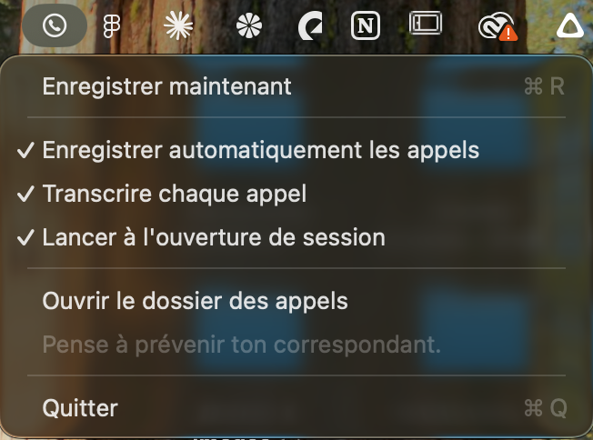

# Enregistreur d'appels

> 🇬🇧 **macOS call recorder with local transcription.** A tiny menu bar app that automatically records calls made with the Mac's **Phone** or **FaceTime** app and **video calls** (Google Meet, Zoom, Teams, WhatsApp…) (your voice from the mic + the other person's voice from system audio), then transcribes them **100 % offline** with [whisper.cpp](https://github.com/ggml-org/whisper.cpp), labelling who speaks (*Moi* = me / *Correspondant* = the other person). Free, open source, nothing leaves your Mac. Optional: after a work call, hand the transcript to [Claude Code](https://claude.com/claude-code) to write notes, update your CRM, calendar and send a recap e-mail. Requires macOS 15+, Apple Silicon or Intel. [Download the app](../../releases/latest) · **The app is available in English and French** (menu → *Language*); transcription language is detected automatically. The docs below are in French. ⚠️ Always tell the other person you are recording — it's required by law in many countries.

<p align="center"></p>

Petite app macOS qui vit dans la barre de menus et **enregistre les appels passés avec l'app Téléphone ou FaceTime** du Mac **et les visios** (Google Meet, Zoom, Teams, WhatsApp…), puis les **transcrit en local** en indiquant qui parle.

```
Appel du 12/11/2026 à 14h05 — 6 min 20 s

[00:00] Correspondant : Bonjour, c'est Claire de la boulangerie des Tilleuls.
[00:04] Moi : Ah bonjour ! Oui, je vous écoute.
```

- 🎙️ **Ta voix** vient du micro, **celle de ton correspondant** du son du Mac : les deux sont enregistrées séparément puis mixées dans un `.m4a`.
- 📞 **Automatique** : l'enregistrement démarre quand un appel Téléphone / FaceTime ou une visio (navigateur, Zoom, Teams, WhatsApp, Slack, Discord…) utilise le micro, et s'arrête quand tu raccroches. Bouton manuel disponible aussi.
- 🤖 **Appel pour le boulot ?** À la fin de l'appel, une fenêtre te le demande. Si oui, avec un petit descriptif, l'appel est confié à Claude Code (voir plus bas).
- 📝 **Transcription « Moi / Correspondant »** avec [whisper.cpp](https://github.com/ggml-org/whisper.cpp), entièrement sur ton Mac : rien ne part sur internet.
- 🔇 Les phrases que le micro réentend par les haut-parleurs sont retirées, et les silences sont ignorés (détecteur de voix Silero).
- 📁 Tout est rangé dans `~/Documents/Appels enregistrés/`.
- 🌍 **Français ou anglais** : choisis la langue de l'app dans le menu **Langue**. La langue de l'appel est détectée automatiquement pour la transcription.

> ⚠️ **Préviens toujours ton correspondant.** Enregistrer une conversation privée sans le consentement de la personne est illégal dans de nombreux pays (en France : article 226-1 du Code pénal).

## Prérequis

- macOS 15 (Sequoia) ou plus récent, Mac Apple Silicon ou Intel
- Pour passer des appels depuis le Mac : un iPhone avec les « Appels sur d'autres appareils » activés (Continuité)
- Pour la transcription (facultatif) : [Homebrew](https://brew.sh)

## Installation

### Option 1 — Télécharger l'app

1. Télécharge `Enregistreur-d-appels.zip` dans les [Releases](../../releases), décompresse-le et glisse l'app dans **Applications**.
2. L'app n'est pas notarisée par Apple : au premier lancement, macOS la bloque. Ouvre **Réglages Système → Confidentialité et sécurité** et clique **« Ouvrir quand même »**. Ou, dans le Terminal :
   ```bash
   xattr -dr com.apple.quarantine "/Applications/Enregistreur d'appels.app"
   ```

### Option 2 — Compiler soi-même

Il faut les outils de développement d'Apple (`xcode-select --install`).

```bash
git clone https://github.com/lucalumpa/enregistreur-appels.git
cd enregistreur-appels
./build.sh            # compile et installe dans ~/Applications
```

`./build.sh --release` produit en plus `build/Enregistreur-d-appels.zip` (app universelle Apple Silicon + Intel).

### Activer la transcription

```bash
brew install whisper-cpp
mkdir -p ~/.whisper && cd ~/.whisper
curl -LO https://huggingface.co/ggerganov/whisper.cpp/resolve/main/ggml-large-v3-turbo.bin      # ~1,6 Go
curl -LO https://huggingface.co/ggml-org/whisper-vad/resolve/main/ggml-silero-v5.1.2.bin        # ~1 Mo
```

L'app détecte Whisper toute seule : l'option **« Transcrire chaque appel »** apparaît dans le menu. Compte environ 20 s de calcul par minute d'appel sur un Mac M1.

## Premier lancement

macOS demande deux autorisations : **Micro** et **Enregistrement audio système**. Accepte les deux, sinon l'enregistrement reste bloqué ou silencieux. Coche ensuite **« Lancer à l'ouverture de session »** dans le menu pour que l'app démarre toute seule.

## Confier un appel boulot à Claude (facultatif)

Si [Claude Code](https://claude.com/claude-code) est installé (`brew install --cask claude-code`, puis `claude` une fois pour te connecter), l'app te demande à la fin de chaque appel **« Cet appel est pour le boulot ? »**. Sur **Oui**, avec un descriptif (qui est le client, son e-mail…), une fenêtre Terminal s'ouvre avec Claude, qui reçoit la transcription.

Ce que Claude fait ensuite, c'est toi qui le décides dans un fichier **`CLAUDE.md`** placé dans `~/Documents/Appels enregistrés/`. Par exemple :

```markdown
# Traitement de mes appels boulot
1. Rédige des notes propres de tout ce qui s'est dit (sans rien oublier).
2. Crée ou mets à jour la fiche du client dans ma base Notion « Clients ».
3. Ajoute la date de tournage à mon calendrier, avec l'adresse.
4. Rédige un mail récap au client et montre-le-moi avant de l'envoyer.
5. S'il manque une info ou que tu as un doute, pose-moi tes questions d'abord.
```

Claude utilise les connecteurs de ton compte (Notion, agenda, mail…). Pour qu'il travaille sans te demander à chaque étape, autorise ses outils dans `~/Documents/Appels enregistrés/.claude/settings.json`. Le menu propose aussi **« Envoyer le dernier appel à Claude… »** si tu as fermé la fenêtre trop vite.

## Si l'enregistrement automatique ne se déclenche pas

Pendant un appel, lance :

```bash
"/Applications/Enregistreur d'appels.app/Contents/MacOS/EnregistreurAppels" --processus
```

La liste montre les processus qui utilisent le micro ; ceux reconnus comme un appel sont marqués `APPEL`. Si ton appel n'y est pas, ajoute son identifiant à `callBundleIDs` ou `meetingBundlePrefixes` dans [`Sources/App.swift`](Sources/App.swift) et ouvre une issue.

## Comment ça marche

| Fichier | Rôle |
|---|---|
| [`App.swift`](Sources/App.swift) | Menu de la barre de menus, détection des appels, démarrage/arrêt automatique |
| [`CallRecorder.swift`](Sources/CallRecorder.swift) | Capture du son système (*process tap* Core Audio) et du micro, puis mixage |
| [`Transcriber.swift`](Sources/Transcriber.swift) | Whisper voix par voix, fusion « Moi / Correspondant », filtres anti-écho et anti-boucles |
| [`CoreAudioUtils.swift`](Sources/CoreAudioUtils.swift) | Petites fonctions d'accès à Core Audio |
| [`Localization.swift`](Sources/Localization.swift) | Choix de la langue et textes français / anglais |
| [`WorkCall.swift`](Sources/WorkCall.swift) | Fenêtre « pour le boulot ? » et envoi de l'appel à Claude Code |

## Licence

[MIT](LICENSE)
